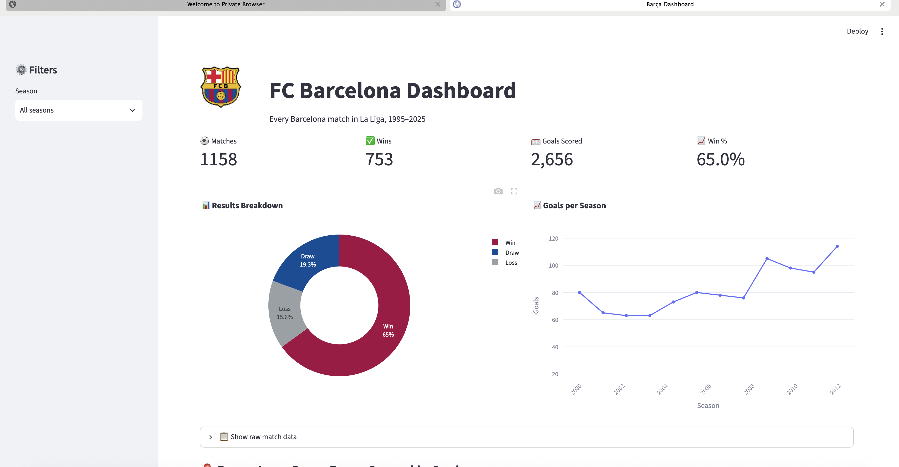
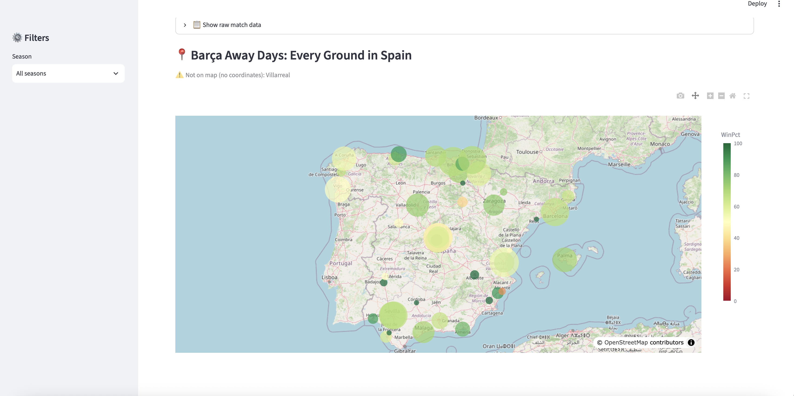
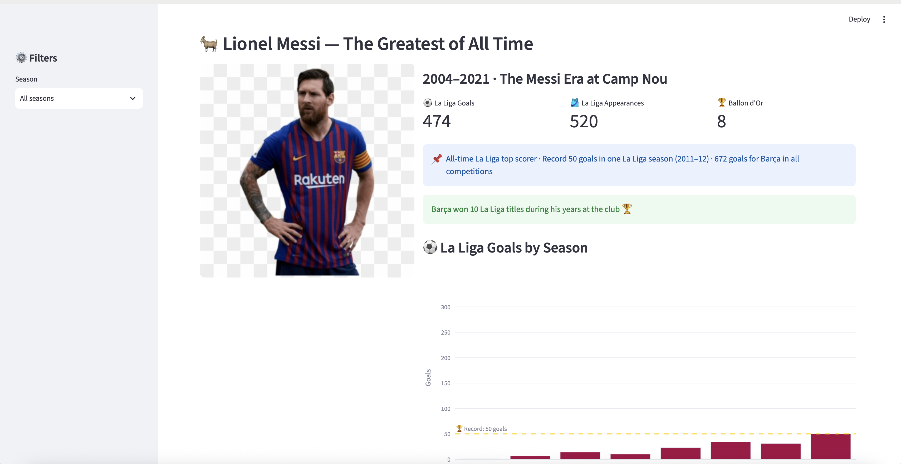

# 🔵🔴 FC Barcelona Dashboard

An interactive web app exploring **30 years of FC Barcelona in La Liga (1995–2025)** —
built with **Python, Streamlit, Pandas and Plotly**.

## 🚀 Live Demo

👉 [Add your Streamlit link here after deploying — e.g. https://barca-dashboard.streamlit.app]

## ✨ Features

- 📊 **Live KPI cards** — matches, wins, goals, win % (all reactive to filters)
- 🎛️ **Season filter** in the sidebar — every number updates instantly
- 🍩 **Results donut chart** in official blaugrana colors
- 📈 **Goals-per-season trend** with the Messi era highlighted
- 🗺️ **Interactive map of Spain** — every away ground, sized by matches,
  colored by win %, with hover details
- 🐐 **Lionel Messi card** — career numbers + goals-by-season chart
- ⚔️ **El Clásico zone** — full head-to-head record vs Real Madrid,
  biggest wins, goals tally
- 🏆 **La Liga titles counter** — champions computed from raw match data
  for every season since 1995

## 📁 Project Structure
## 📸 Screenshots

### Dashboard Overview

### Away Days Map

### The Messi Card

